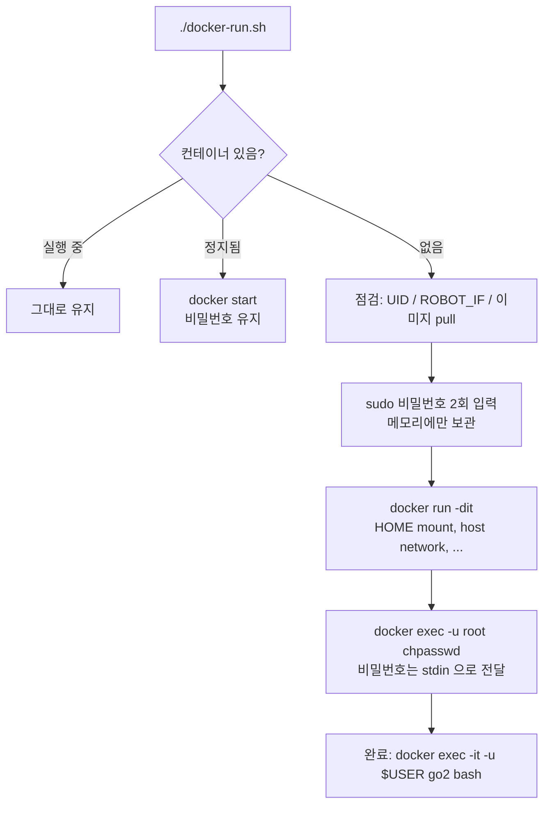
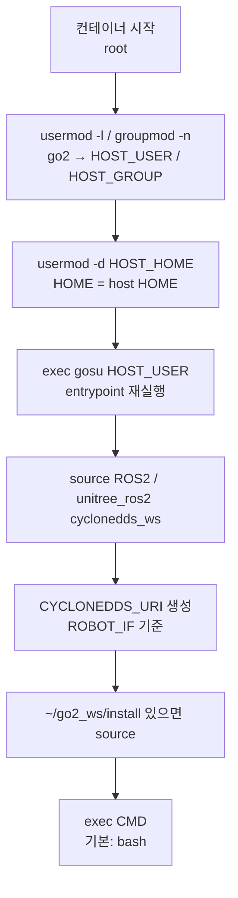

# mirgaon/go2-humble — Docker Image 구성

Unitree Go2 EDU low-level 제어용 ROS2 Humble 개발 환경 이미지.

| 항목 | 내용 |
|---|---|
| Docker Hub | `mirgaon/go2-humble:latest` (버전 tag: `v2.0.0`) |
| Source | https://github.com/jinwoopark99/Dockerfile_unitreego2 |
| 대상 기기 | Go2 EDU Jetson (arm64, JetPack 6 / L4T r36) |
| OS (컨테이너) | Ubuntu 22.04 |
| ROS | ROS2 Humble (`ros-base`) |
| DDS | CycloneDDS 0.10.x (`rmw_cyclonedds_cpp`) |
| Unitree | `unitree_ros2` (msg), `unitree_sdk2` (C++ SDK) |

---

## 1. 설계 원칙

1. **배포용 이미지**
   - build한 기기의 user, UID, 비밀번호 등 host 정보를 이미지에 넣지 않음.
   - 대신 **실행 시점에** 컨테이너 안 사용자(UID 1000)의 이름·HOME을 host 사용자와 같게 맞춤.
   - 같은 이미지를 어느 Jetson에서나 pull해서 사용.
2. **최소 구성**
   - Go2 low-level 제어에 필요한 것만 설치.
   - 자체 코드는 이미지에 넣지 않음. 실행 시 **host HOME을 컨테이너의 같은 경로로 mount**해서 host 파일을 그대로 사용.
3. **재현 가능한 build**
   - 외부 git source는 `versions.env`의 commit hash로 고정.
4. **비밀번호는 컨테이너 생성 시점에 설정**
   - 이미지 안의 계정은 잠긴 상태.
   - `docker-run.sh`가 컨테이너를 만들 때 입력받아 컨테이너 안에만 설정 (host 파일에도 저장하지 않음).

---

## 2. Repository 구성

```
Dockerfile_unitreego2/
├── Dockerfile              # 이미지 정의
├── versions.env            # 외부 git source 고정 commit
├── build.sh                # versions.env 를 읽어 build
├── entrypoint.sh           # go2 HOME 설정 → go2 전환 → ROS 환경 설정
├── docker-run.sh           # 컨테이너 생성/시작/정지/삭제 + sudo 비밀번호 설정 (기본 실행 방법)
├── docker-compose.yml      # compose 실행 설정 (보조)
├── README.md
├── .gitattributes          # *.sh / Dockerfile / *.env / *.yml → LF 고정
├── .gitignore              # .DS_Store
└── docs/
    ├── container-usage.md       # 컨테이너 사용법
    ├── image-architecture.md    # 이 문서
    └── portable-image-plan.md   # v1 → v2 수정 내역
```

---

## 3. Image Layer 구조

"거의 안 바뀌는 것 → 자주 바뀌는 것" 순서. 아래쪽만 바뀌면 위쪽은 build cache를 재사용함.

```
┌─────────────────────────────────────────────────────────────┐
│ 5. Entrypoint / shell 환경                                   │  자주 바뀜
│    /usr/local/bin/entrypoint.sh, /etc/bash.bashrc            │
├─────────────────────────────────────────────────────────────┤
│ 4b. unitree_sdk2 (C++)              → /opt/unitree_robot      │
├─────────────────────────────────────────────────────────────┤
│ 4. unitree_ros2 + CycloneDDS 0.10.x → /opt/unitree_ros2       │
├─────────────────────────────────────────────────────────────┤
│ 3. user go2 (UID/GID 1000) + rosdep cache                    │
├─────────────────────────────────────────────────────────────┤
│ 2. apt: ROS2 Humble + CycloneDDS rmw + Go2 필수 패키지        │
├─────────────────────────────────────────────────────────────┤
│ 1. Base: nvcr.io/nvidia/l4t-jetpack:r36.4.0                  │  거의 안 바뀜
└─────────────────────────────────────────────────────────────┘
```

### Layer 1. Base image

| 항목 | 값 |
|---|---|
| 기본값 | `nvcr.io/nvidia/l4t-jetpack:r36.4.0` |
| 변경 | `./build.sh <BASE_IMAGE>` |
| 대안 | `ubuntu:22.04` (GPU 불필요, 경량) |

- L4T 버전(`r36.x`)은 host Jetson의 `cat /etc/nv_tegra_release`와 맞출 것.
- 환경변수: `LANG=en_US.UTF-8`, `LC_ALL=en_US.UTF-8`, `TZ=Asia/Seoul`
- 모든 `RUN`은 `bash -c`로 실행.

### Layer 2. apt 패키지

| 분류 | 패키지 |
|---|---|
| ROS2 core / build | `ros-humble-ros-base`, `ros-dev-tools`, `python3-colcon-common-extensions`, `python3-rosdep` |
| DDS | `ros-humble-rmw-cyclonedds-cpp`, `ros-humble-rosidl-generator-dds-idl` |
| Go2 제어 | `ros-humble-joy`, `ros-humble-rosbag2-storage-mcap`, `libyaml-cpp-dev`, `libeigen3-dev`, `libboost-dev` |
| C++ / Python | `build-essential`, `cmake`, `git`, `pkg-config`, `python3-pip`, `python3-numpy` |
| Dev / Debug | `sudo`, `vim`, `tmux`, `htop`, `gdb`, `net-tools`, `iputils-ping`, `iproute2`, `joystick`, `evtest` |
| 권한 전환 | `gosu` (컨테이너 시작 시 root → go2) |

- `(rosdep init || true)`로 괄호를 묶어서, apt 설치 실패가 `|| true`에 묻히지 않게 함.

### Layer 3. User

| 항목 | 값 |
|---|---|
| user / group | `go2` / `go2` (이미지 안 이름. 실행 시 host 사용자 이름으로 변경됨, 6번 참고) |
| UID / GID | `1000` / `1000` (고정) |
| 이미지 안 HOME | `/home/go2` (실행 시 host HOME으로 변경됨, 6번 참고) |
| 보조 group | `sudo`, `dialout`, `input`, `plugdev`, `video` |
| 비밀번호 | **없음 (잠김, `/etc/shadow`의 값 `!`)** |

- base image에 없는 group은 build 중 생성.
- `rosdep update`는 `go2`로 실행 (`/home/go2/.ros`). 실행 시에는 HOME이 host로 바뀌므로 이 cache는 쓰이지 않음 → 컨테이너에서 rosdep을 쓸 때 처음 한 번 `rosdep update`.

### Layer 4. unitree_ros2 + CycloneDDS

| 항목 | 값 |
|---|---|
| 설치 경로 | `/opt/unitree_ros2` |
| workspace | `/opt/unitree_ros2/cyclonedds_ws` |
| 포함 | `cyclonedds` (0.10.x), `rmw_cyclonedds` (humble), `unitree_go` / `unitree_api` / `unitree_hg` msg |
| build | root, `colcon build --parallel-workers 2`, 끝나면 `build/`, `log/` 삭제 |

Build 순서는 unitree_ros2 README를 따름.
1. ROS를 source하지 않은 상태에서 `cyclonedds`만 build
2. ROS를 source한 뒤 workspace 전체 build

> Humble은 apt의 rmw가 이미 CycloneDDS 0.10.x 기반이라 소스 build가 필수는 아님. 실기에서 검증된 조합이라 유지함.

### Layer 4b. unitree_sdk2

| 항목 | 값 |
|---|---|
| 설치 경로 | `/opt/unitree_robot` |
| build | root, `cmake --build -j2` → `cmake --install` (`/tmp`에서 build 후 삭제) |
| 용도 | MotionSwitcher / Sport mode 전환, stand example 등 |

### Layer 5. Entrypoint / shell 환경

| 항목 | 값 |
|---|---|
| ENV | `RMW_IMPLEMENTATION=rmw_cyclonedds_cpp`, `ROBOT_IF=eth0`, `ROS_DOMAIN_ID=0` (실행 시 `docker-run.sh`가 덮어씀) |
| ENTRYPOINT | `/usr/local/bin/entrypoint.sh` |
| CMD | `bash` |
| 시작 user | **root** (`USER` 미지정) → entrypoint에서 host 사용자 이름으로 바꾼 UID 1000 계정으로 전환 |
| `/etc/bash.bashrc` | `source /usr/local/bin/entrypoint.sh --env-only` 추가 (HOME이 host로 바뀌어도 모든 interactive bash에 적용) |

---

## 4. 컨테이너 내부 경로

| 경로 | 내용 | 소유 | 출처 |
|---|---|---|---|
| `/opt/ros/humble` | ROS2 Humble | root | apt |
| `/opt/unitree_ros2` | unitree_ros2 + CycloneDDS workspace | root | 이미지 |
| `/opt/unitree_robot` | unitree_sdk2 | root | 이미지 |
| `/usr/local/bin/entrypoint.sh` | entrypoint | root | 이미지 |
| `/home/go2` | 이미지 안 기본 HOME (실행 시 사용 안 함) | UID 1000 | 이미지 |
| **`${HOME}` (예: `/home/unitree`)** | **실제 HOME = host HOME** | UID 1000 (host 사용자) | host mount |

- 설치물은 `/opt`(root, 읽기 전용으로 사용), 작업물은 host HOME(mount)으로 분리.
- `~/go2_ws`, `~/go2_bags` 등은 host HOME에 있는 그대로 보임.

---

## 5. 버전 고정 (`versions.env`)

2026-10-28 기준.

| 변수 | repo | commit |
|---|---|---|
| `UNITREE_ROS2_REF` | unitreerobotics/unitree_ros2 | `668d1ec5a05d1c38d3306bdca7d59f2ba3581a88` |
| `UNITREE_SDK2_REF` | unitreerobotics/unitree_sdk2 | `d1abf001220d3e5f59e00a0c4aaa595e00089a4a` |
| `RMW_CYCLONEDDS_REF` | ros2/rmw_cyclonedds (humble) | `a58b9c56141f970e755e6bb2d2cae52843afdf13` |
| `CYCLONEDDS_REF` | eclipse-cyclonedds/cyclonedds (releases/0.10.x) | `5041f3560c088c99e5088b2b8520b69169621196` |
| `UNITREE_MUJOCO_REF` | unitreerobotics/unitree_mujoco | `1eb6642e3f3fdfb7fb13a9794fd6a2dd93ea0e7d` (sim용, 현재 미사용) |

- `build.sh`가 읽어 `--build-arg`로 전달. 값이 비면 Dockerfile이 build를 실패시킴 → 반드시 `./build.sh` 사용.
- apt 패키지는 ROS apt repo가 최신 버전만 유지하므로 완전히 고정되지 않음. 완전한 재현은 Docker Hub의 이미지 tag/digest 기준.

---

## 6. 실행 흐름

### 6-1. 컨테이너 생성 (`docker-run.sh`)



### 6-2. 컨테이너 시작 (entrypoint)



| 순서 | go2 구간 환경 설정 |
|---|---|
| 1 | `source /opt/ros/humble/setup.bash` |
| 2 | `source /opt/unitree_ros2/cyclonedds_ws/install/setup.bash` |
| 3 | `RMW_IMPLEMENTATION=rmw_cyclonedds_cpp` |
| 4 | `CYCLONEDDS_URI` 생성 (`ROBOT_IF`의 interface 사용) |
| 5 | `~/go2_ws/install/setup.bash`가 있으면 source |

- `docker exec -it -u $USER`로 들어온 shell은 `/etc/bash.bashrc`의 `--env-only`로 1~5번만 적용.
- interactive bash는 `/etc/bash.bashrc` → host `~/.bashrc` 순서로 읽음 → host `~/.bashrc`의 설정이 컨테이너 환경을 덮어쓸 수 있음 (10번 참고).

---

## 7. 실행 설정 (`docker-run.sh`)

| 분류 | 옵션 | 목적 |
|---|---|---|
| 이름 | `--name go2`, `--hostname go2-dock`, `--add-host go2-dock:127.0.1.1` | sudo hostname 경고 방지 포함 |
| Network | `--network host`, `--ipc host`, `--pid host` | DDS multicast / shared memory |
| Real-time | `--cap-add SYS_NICE`, `--ulimit rtprio=99`, `--ulimit memlock=-1` | 500 Hz low-level loop |
| HOME | `-v ${HOME}:${HOME}`, `-w ${HOME}`, `-e HOST_HOME=${HOME}` | host HOME을 같은 경로로 사용 |
| 사용자 | `-e HOST_USER=$(id -un)`, `-e HOST_GROUP=$(id -gn)` | 컨테이너 안 사용자 이름을 host와 같게 |
| DDS | `-e ROBOT_IF` (기본 `enP8p1s0`), `-e ROS_DOMAIN_ID` (기본 0) | |
| GUI | `-e DISPLAY`, `-e QT_X11_NO_MITSHM=1`, `-v /tmp/.X11-unix` | rviz2 등 |
| 조건부 | `--runtime nvidia`, `--device /dev/input`, `--device /dev/bus/usb`, `-v /run/jtop.sock` | host에 있을 때만 추가 |

`docker-compose.yml`도 같은 계열 설정이지만 비밀번호 설정이 없고 `ROBOT_IF` 기본값이 `eth0`임. 기본 실행 방법은 `docker-run.sh`.

---

## 8. 사용법 요약

```bash
git clone https://github.com/jinwoopark99/Dockerfile_unitreego2 ~/go2_docker
cd ~/go2_docker
./docker-run.sh                       # 생성 (이미지 자동 pull, 비밀번호 입력)
docker exec -it -u $USER go2 bash     # 접속
./docker-run.sh --password            # 비밀번호 변경
./docker-run.sh --recreate            # 새 이미지로 교체
```

자세한 내용: `docs/container-usage.md`

---

## 9. 보안 모델

| 항목 | 처리 |
|---|---|
| 이미지 안 비밀번호 | 없음. UID 1000 계정(`go2`) 잠김 (`!`) |
| host 정보 | build arg로 받지 않음 (user, UID, 비밀번호 모두) |
| sudo 비밀번호 | `docker-run.sh`가 생성 시 입력받아 `docker exec ... chpasswd`로 설정. stdin 전달이라 명령줄 / 환경변수 / `docker inspect`에 남지 않음 |
| 비밀번호 저장 위치 | 컨테이너 안 `/etc/shadow`만. host 파일 없음 |
| 비밀번호 수명 | 정지/재시작 시 유지, 컨테이너 삭제 시 함께 삭제 |
| root 사용 범위 | entrypoint 시작 직후 이름·HOME 설정 구간만. 이후 모든 프로세스는 host 사용자와 같은 UID 1000 계정 |

**push 전 확인**
```bash
docker run --rm --entrypoint grep mirgaon/go2-humble:latest '^go2:' /etc/shadow   # go2:!:...
docker history --no-trunc mirgaon/go2-humble:latest | grep -i -E "pass|secret|shadow"   # 출력 없음
```

---

## 10. 알려진 제한사항 / 보류 항목

| 항목 | 내용 | 대응 |
|---|---|---|
| UID 1000 가정 | host UID가 1000이 아니면 HOME 파일 권한 불일치 | `docker-run.sh`가 경고 |
| `ROBOT_IF` 기본값 | `enP8p1s0`은 개발 기기 기준. 기기마다 다를 수 있음 | `ROBOT_IF=<이름> ./docker-run.sh`, 없으면 경고 |
| L4T 버전 결합 | base가 r36.4.0이라 JetPack 6 Jetson 전용 | |
| arm64 전용 | Jetson에서 build. amd64 PC에서는 실행 불가 | 대상 아님 |
| `exec -u $USER` 필요 | 시작 user가 root라 `exec` 기본값이 root | alias 사용 |
| 이름 충돌 | host 사용자 이름이 이미지에 이미 있는 계정(예: `root`)과 같으면 이름 변경을 건너뛰고 `go2` 유지 (경고 출력) | `-u 1000`으로 접속 |
| host `~/.bashrc` 실행 | HOME mount로 host `.bashrc`가 컨테이너 shell에서도 실행됨 | host 전용 설정은 `if [ ! -f /.dockerenv ]; then ... fi` |
| rosdep cache | 이미지의 cache는 쓰이지 않음 | 컨테이너에서 rosdep 사용 시 `rosdep update` 1회 |
| HOME 노출 범위 | host HOME 전체를 같은 UID로 읽고 쓸 수 있음 | host 계정과 동일 권한, 신뢰하는 이미지에서만 사용 |
| 조이스틱 group | host와 컨테이너의 `input` group GID가 다르면 `/dev/input/event*` 권한 문제 가능 | 보류 (`--group-add <host input GID>`로 해결 예정) |
| sim domain | unitree_mujoco 기본 `domain_id: 1` | sim 사용 시 `ROS_DOMAIN_ID=1 ./docker-run.sh` |
| hostname `go2-dock` | host와 구분하려고 다르게 둠. X11 cookie가 host hostname 기준이라 GUI 앱이 인증 실패할 수 있음 (ROS2/DDS는 영향 없음) | host에서 `xhost +si:localuser:$USER` |
| `ros2 daemon` 공유 | `--network host`라 host에도 ROS2가 있으면 같은 daemon port를 공유할 수 있음 | 이상하면 `ros2 daemon stop` |
| compose | 비밀번호 설정 없음, `runtime: nvidia`/jtop mount 고정 | `docker-run.sh` 사용 권장 |

---

## 11. 버전 이력

| 버전 | git tag | 내용 |
|---|---|---|
| v1 | `v1.0.0` (`70ad510`) | host user / UID / 비밀번호 hash를 build 시 이미지에 포함. 로컬 전용 |
| v2 | `v2.0.0` (예정) | 고정 user `go2`, `/opt` 설치 경로, `versions.env` 버전 고정, apt `\|\| true` 버그 수정, `sudo make install` 제거, host HOME 같은 경로 mount, 컨테이너 안 사용자 이름을 host와 같게, 컨테이너 생성 시 비밀번호 입력(`docker-run.sh`), Docker Hub 이미지 이름 적용 |
